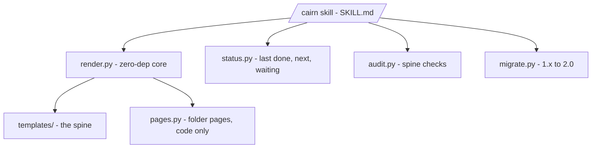

# Architecture - cairn

## Intent
A zero-dependency documentation spine that keeps any project legible over
time: cheap to start, cheap to keep true. Cairn writes the few short
onboarding documents and checks they stay short, current and linked, so a
reader (human or LLM) learns what, how and where from root CLAUDE.md,
README and ARCHITECTURE in minutes. It works when a newcomer reads those
three (about 1.3K tokens, held there by the budgets) and can act without
reading the source.

## Invariants
- **Zero-dependency core.** Python standard library only.
- **No-clobber.** Never overwrites authored content; fills only the gaps.
- **One question, one budget.** Each file answers one question under a size
  budget enforced as a check ([ADR 0009](decisions/0009-onboarding-documents-replace-the-strata.md)).
- **Anti-rot.** One diagram, here. ADRs are append-only: supersede, never
  edit. Nothing in flight is stored; `/cairn status` derives it.
- **Humans own the why.** Machines copy only regenerable lines (docstrings),
  never as the source of record, committed only behind the freshness check.
- **The spine is portable; modules are not.** CLAUDE, README, ARCHITECTURE
  and CONTRIBUTING suit any project; folder pages and the status command
  are the software module.

## Non-goals
Not owned by any consumer. Not a code-analysis engine (it reads the folder
tree and each file's first docstring line). Not a docs-site generator. Not
a content author: it writes frames, and tags inferred lines for correction.

## Diagram

## Folder map

| Folder | Purpose |
|---|---|
| [skills/cairn/](skills/cairn/) | The skill: engine scripts and templates |
| [tests/](tests/) | The pytest suite |
| [scripts/](scripts/) | Branch-protection ruleset for `main` |
| [decisions/](decisions/) | Decision records, append-only |
| [docs/](docs/) | Usage guide, design, features, roadmap |

## Where things live
Each fact lives in one place. Look it up here instead of guessing.

| Kind of fact | Home |
|---|---|
| What it is and how to use it | [README.md](README.md) |
| Intent, invariants, folder map | This file |
| How work is done | [CONTRIBUTING.md](CONTRIBUTING.md) |
| One kind of work | Its recipe page in [docs/](docs/) |
| A decision | Its ADR in [decisions/](decisions/) |
| A feature's what and why; its design | Its document in [docs/](docs/) |
| Backlog and open questions | Issues |
| Last done, next, and what waits on you | The status command, `/cairn status` |
| Releases | [CHANGELOG.md](CHANGELOG.md) |
| This machine's paths and tools | `CLAUDE.local.md` (untracked) |
