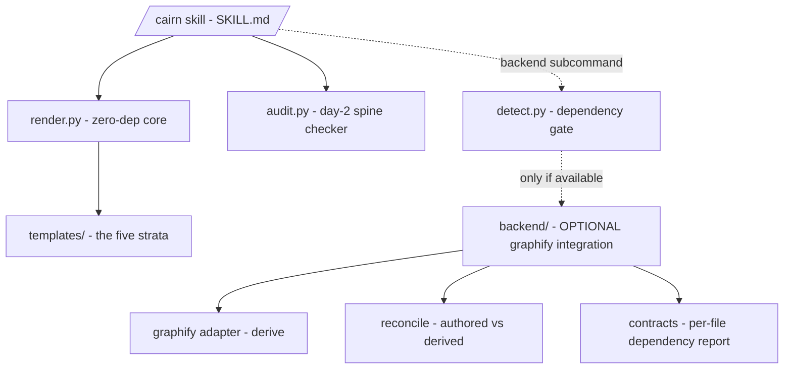

# Map - cairn

> **Contract** - one question: *what are the pieces, and how do they connect?*
> <=2 pages - update on add / remove / rewire of a Component - hand-edited.

## Diagram

<!-- The ONE diagram, at container zoom. Solid edges = the zero-dep core;
     dashed edges = the optional, dependency-gated backend. -->

## Components

### Core - zero-dependency
| Component | Responsibility (one line) | Status | Deep doc |
|---|---|---|---|
| `render.py` | Substitute the five templates into a project (no-clobber, date-stamped). The whole core engine. | stable | USAGE.md |
| `audit.py` | Deterministic spine checker - the DOCS-SYSTEM checklist, executable (report-only, git-optional). | stable | `docs/audit.md` |
| `templates/` | The five strata + DOCS-SYSTEM + seed ADR & ADR-template, with `{{ var }}` slots. | stable | DOCS-SYSTEM.md |
| `SKILL.md` (`/cairn`) | The Claude Code interview, plus dispatch of the day-2 (audit / maintain) and backend subcommands. | stable | no doc yet |
| `detect.py` | Feature-detector that gates the optional backend (absent deps report cleanly, never crash). | stable | no doc yet |

### Backend - OPTIONAL, code-only graphify integration ([[0002-optional-graphify-backend]])
| Component | Responsibility (one line) | Status | Deep doc |
|---|---|---|---|
| `backend/graphify_adapter.py` | `derive` a structured code graph -> `graphify-out/graph.json`. | optional | `docs/backend.md` |
| `backend/reconcile.py` | Diff derived graph vs authored MAP -> `proposals.md`; `--apply` writes accepted rows. | optional | `docs/backend.md` |
| `backend/contracts.py` | Render a deterministic per-file dependency-contract report from the graph. | optional | no doc yet |
| `backend/schema.py` + `vault.py` | Structured-MAP schema (PyYAML) + portfolio vault roll-up (`view`). | optional | `docs/backend.md` |
| `backend_cli.py` + `backend/__main__.py` | Absolute-path launcher + subcommand dispatch (derive / reconcile / view / stage / validate / vault-add). | stable | `docs/backend.md` |

## Cross-cutting notes
- **Core vs backend is the load-bearing seam.** The core is zero-dependency and
  self-contained; everything under Backend is optional and dependency-gated by
  `detect.py` ([[0002-optional-graphify-backend]]).
- **Derived output is regenerable + gitignored** (`graphify-out/`,
  `/manifest.json`); authored markdown is the source of record.
- Docs live outside the strata: `README.md` (overview) + `USAGE.md`
  (step-by-step). The optional backend has a `docs/` page: `docs/backend.md`.
