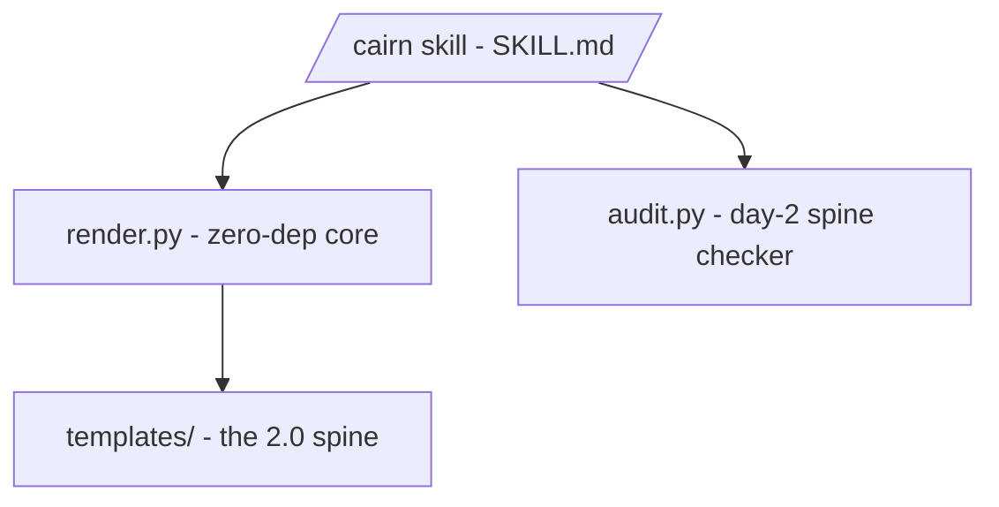

# Map - cairn

> **Contract** - one question: *what are the pieces, and how do they connect?*
> <=2 pages - update on add / remove / rewire of a Component - hand-edited.

## Diagram

<!-- The ONE diagram, at container zoom. -->

## Components

### Core - zero-dependency
| Component | Responsibility (one line) | Status | Deep doc |
|---|---|---|---|
| `render.py` | Substitute the 2.0 spine templates into a project (no-clobber, date-stamped, tracked mode). The whole core engine. | stable | `docs/usage-2.0.md` |
| `audit.py` | Deterministic spine checker - the DOCS-SYSTEM checklist, executable (report-only, git-optional). Still checks the 1.x strata until Pass 5. | stable | `docs/audit.md` |
| `templates/` | The 2.0 spine templates, plus the 1.x strata kept only as the audit test fixture until Pass 6, with `{{ var }}` slots. | stable | `docs/usage-2.0.md` |
| `SKILL.md` (`/cairn`) | The Claude Code interview, plus dispatch of the day-2 (audit / maintain) subcommands. | stable | no doc yet |
| `prompt-lang.config.yaml` | PromptLang claim for the skill prompt - registers its section tags; write-time hook + `tests/test_promptlang.py` enforce ([[0007-adopt-promptlang-for-the-skill-prompt]]). | stable | no doc yet |

## Cross-cutting notes
- **Zero dependencies.** The graphify backend was removed in 2.0 Pass 1;
  it built `MAP.md`, which 2.0 retires ([[0009-onboarding-documents-replace-the-strata]]).
- Docs live outside the strata: `README.md` (overview) + `USAGE.md`
  (step-by-step), both still describing 1.2 until Pass 7.
- **2.0 is being built**: `docs/design-2.0.md` (design + rulings),
  `docs/features-2.0.md` (ratified feature list) and `docs/usage-2.0.md`
  (user guide, status markers per feature); [[0009-onboarding-documents-replace-the-strata]].
